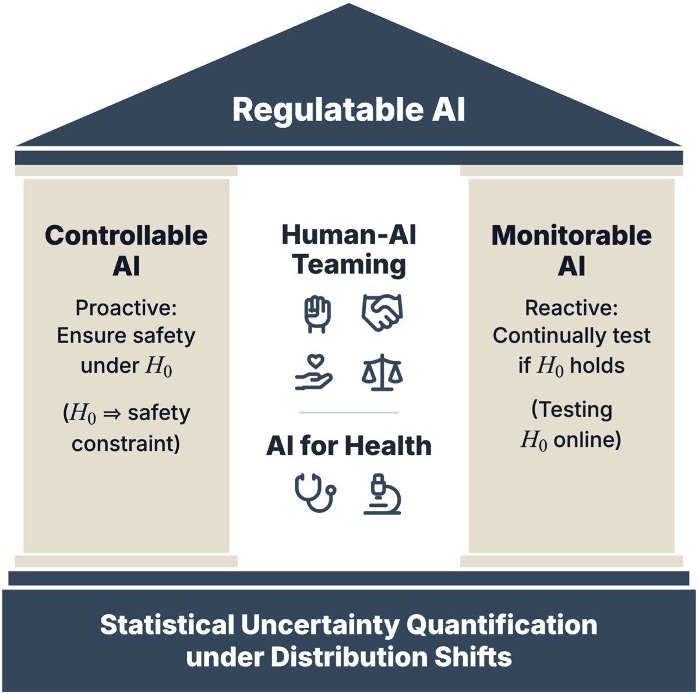

Hi, I'm Drew. I'm a PhD student in computer science at Johns Hopkins University. I aim to advance our understanding and the realization of **regulatable** AI systems, especially in healthcare and biomedical research. 
I approach this goal with the following agenda:

<figure style="float: right; width: 275px; max-width: 35%; margin: 0 0 1em 1.5em;">
  
</figure>

1. **[Statistical Uncertainty Quantification:](#uq-shift)** I contribute to a foundation for AI uncertainty quantificiation, for example by extending conformal prediction to arbitrary data shifts and those induced by AI agents.
1. **[AI Control:](#ai-control)** Building on this bedrock, I work on methods to provably enforce stakeholders' safety constraints on AI agent behaviors, even as they advance in capabilities.
1. **[AI Monitoring:](#ai-monitoring)** To audit conditions required for safety assurances, I develop sequential hypothesis testing tools for system monitoring. 
1. **[Human-AI Teaming:](#human-ai-teaming)** To better understand the constraints to regulate for in the first place, I collaborate with stakeholders in healthcare and biomedical research, and I study how to design systems for effective human-AI teams.

<!-- My research aim is to improve the safety, reliability, and regulatability of AI and machine learning in consequential settings, especially healthcare and bioscience. To these ends, I mainly develop statistical tools (e.g., related to conformal prediction and hypothesis testing) for the design of trustworthy AI systems, safeguards, or auditing tools. For instance, I work on:
- **[AI Control:](#ai-control)** Methods to ensure that AI agents provably respect our declared safety constraints.
- **[AI Monitoring:](#ai-monitoring)** Continual monitoring, safety testing, and root-cause analysis of deployed AI systems.
- **[Uncertainty Quantification:](#uq-shift)** Trustworthy predictive inference under distribution shift.
- **[Human-AI Teaming:](#human-ai-teaming)** Human-centered design for clinical decision-making. -->

I am advised by [Professor Suchi Saria](https://suchisaria.jhu.edu/) and [Professor Anqi Liu](https://anqiliu-ai.github.io/). In 2025, I interned with [Prescient Design](https://www.gene.com/scientists/our-scientists/prescient-design) at Genentech, where I began developing [conformal policy control](#cpc). I have also worked closely with [Professor Chien-Ming Huang](https://www.cs.jhu.edu/~cmhuang/).

Previously at Yale University, I completed my B.S. (with distinction) in computer science and mathematics and was a Yale Global Health Scholar. At Yale I contributed to global health volunteering and research with the nonprofit [Unite For Sight](https://uniteforsight.org/); to microbiome, mental health, and social-network research with Dr. Nicholas Christakis at the [Yale Human Nature Lab](https://humannaturelab.net/); and to statistical testing of metagenome alignments with Dr. Mark Gerstein in the [Gerstein Lab](http://www.gersteinlab.org/).

Contact: drew [at] cs [dot] jhu [dot] edu

